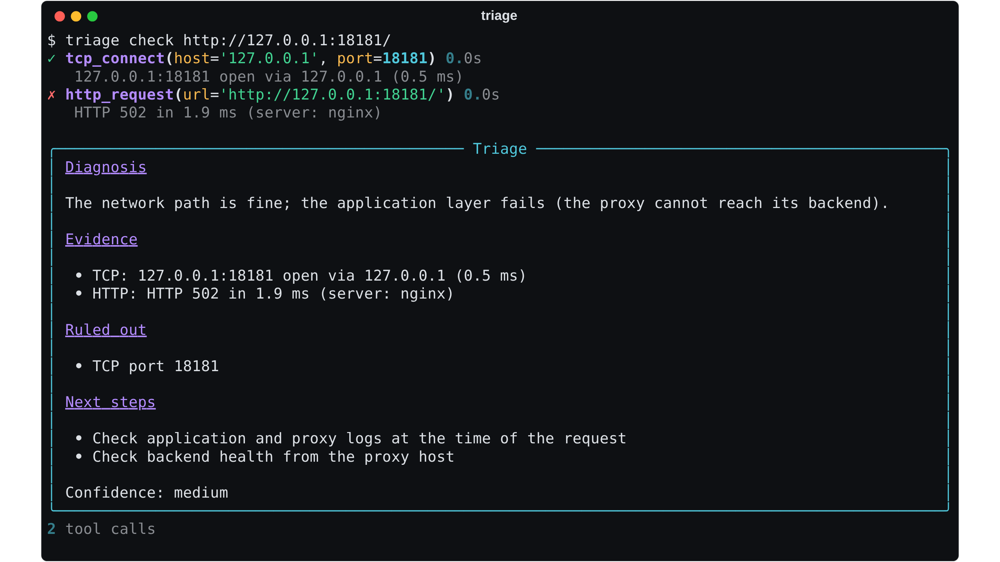

# Triage

[](https://github.com/Jamie-233/triage/actions/workflows/ci.yml)
[](LICENSE)
[](pyproject.toml)
[](https://github.com/Jamie-233/triage/stargazers)

**An AI agent that troubleshoots network problems the way an engineer does** — it forms hypotheses, runs real diagnostics (DNS, routing, ICMP, TCP, TLS, HTTP), narrows the fault layer by layer, and reports a diagnosis that cites its evidence. It works with any OpenAI-compatible model, including local ones through Ollama, and has a fully offline playbook mode.

An abridged example session:

```
$ triage ask "staff can't open https://intranet.corp.lan since this morning" --provider ollama

» Start with name resolution, comparing internal and public resolvers.
✓ dns_lookup(name='intranet.corp.lan')                         0.02s
   A intranet.corp.lan → 10.10.0.20 (3.1 ms, TTL 300)
✓ tcp_connect(host='intranet.corp.lan', port=443)              0.01s
   intranet.corp.lan:443 open via 10.10.0.20 (1.2 ms)
✗ tls_certificate(host='intranet.corp.lan', port=443)          0.04s
   TLSv1.3, CN=intranet.corp.lan, expires in -1 days, NOT VALID: certificate has expired

╭─ Triage ───────────────────────────────────────────────────────────────╮
│ Diagnosis: the server's TLS certificate expired yesterday; DNS and the │
│ HTTPS port are healthy, so browsers block the page at the TLS layer.   │
│ ...                                                                    │
```

## How it works

```
question ─▶ ┌──────────── agent loop (≤ N turns) ─────────────┐
            │  model ──tool calls──▶ registry ──▶ policy ──▶ tools │──▶ diagnosis
            │    ▲                                     │           │    + evidence
            │    └──────── truncated results ◀─────────┘           │    + trace
            └──────────────────────────────────────────────────────┘
```

- **Method in the prompt.** The system prompt encodes a bottom-up procedure — name → route → reachability → port → application → certificate — and requires every conclusion to cite a tool result. The final answer has fixed sections: *Diagnosis, Evidence, Ruled out, Next steps, Confidence*.
- **Parallel tool calls.** Independent checks requested in one turn run concurrently; network diagnostics spend most of their time waiting on timeouts.
- **Errors are observations.** Bad arguments, blocked targets and tool exceptions are returned to the model as results, so it can adapt instead of crashing.
- **Forced conclusion.** On the final turn tools are withheld, so a run always ends with an answer built from the evidence gathered.
- **Schemas from code.** Tool JSON schemas are generated from Python signatures and docstrings, so the contract the model sees can't drift from the code that runs.

## Tools

| Tool | Answers |
|---|---|
| `dns_lookup` | Does the name resolve, to what, and does the internal resolver agree with a public one? |
| `local_route` | Which interface, source address and next hop would this machine use? |
| `subnet_info` | Is the gateway actually inside the host's subnet? What's the usable range? |
| `ping` | Is the host routed? Loss, RTT and jitter. |
| `traceroute` | Where along the path does traffic stop or slow down? |
| `tcp_connect` | Is the port open, refused (service down) or filtered (firewall)? |
| `tls_certificate` | Is the certificate valid, unexpired and issued for this name? |
| `http_request` | Status, timing, redirect chain and proxy headers. |

## Safety

An agent with network tools is a scanner whose target list is written by text — including text it fetches. Guardrails live in the tools, not the prompt, so a prompt injection in an HTTP response cannot widen what the agent may touch:

- **Strict target validation.** Only RFC 1123 hostnames and IP literals; nothing a shell or option parser could interpret. Subprocesses use argument vectors, never a shell.
- **Scope.** `--allow-net 10.10.0.0/16 --allow-domain corp.lan` restricts every probe. Names are re-checked *after* resolution to defeat DNS rebinding, and every HTTP redirect hop is re-validated.
- **SSRF.** Link-local and multicast addresses (including cloud metadata at `169.254.169.254`) are always refused.
- **Budget.** A hard cap on tool calls per run (`--budget`).
- **Untrusted output.** HTTP bodies are truncated and labelled as data the model must not follow.

## Usage

```bash
pip install -e .

# LLM agent — OpenAI, DeepSeek, or local via Ollama
export OPENAI_API_KEY=sk-...
triage ask "guest Wi-Fi users get no internet but staff Wi-Fi works" \
  --context "guest VLAN 20, gateway 10.10.20.1/22 on core-01, DHCP relay to 10.10.0.67"

triage ask "printer at 10.10.30.40 stopped responding" --provider ollama --model qwen2.5:7b
triage ask "..." --base-url http://my-vllm:8000/v1 --model my-model

# Offline layered playbook — no model needed
triage check https://intranet.corp.lan
triage check 10.10.0.20:22

# Restrict scope, export the full trace
triage ask "..." --allow-net 10.10.0.0/16 --allow-domain corp.lan --budget 15 --json
```

## Offline playbook



`triage check` runs the same layered method as a deterministic decision tree and stops at the first failing layer. It keeps Triage useful on isolated networks, and gives a baseline: if the agent can't beat a fixed tree on a problem, the model isn't adding value there.

## Development

```bash
pip install -e '.[dev]'
pytest
```

The agent loop is tested with a scripted model that replays fixed replies and records what it was shown — covering parallel execution, error feedback, budget exhaustion, forced conclusions and result truncation — plus a fake OpenAI-compatible server for the wire format, including 429 retry handling.

## License

MIT
